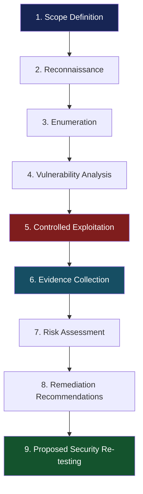
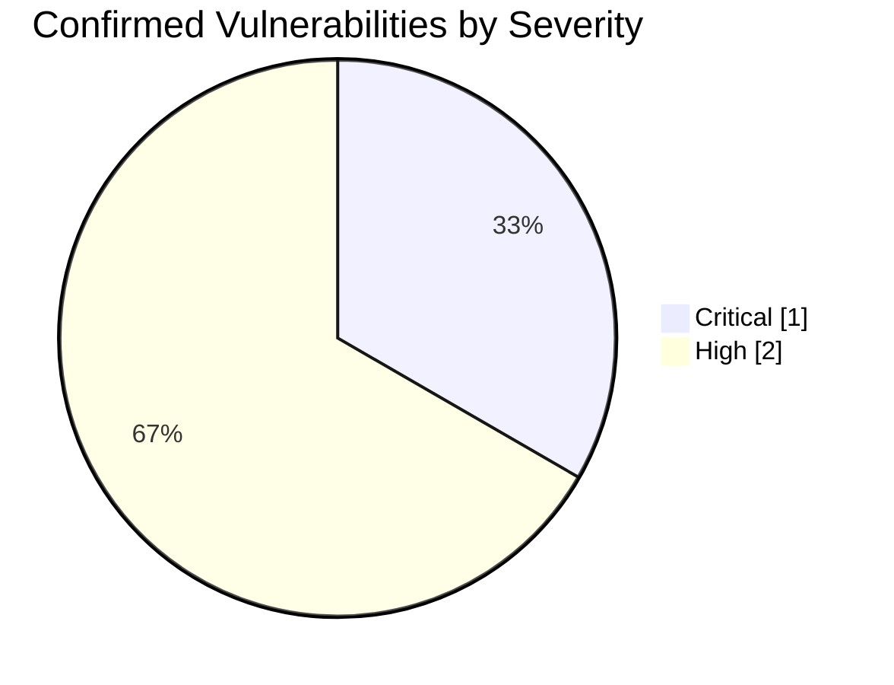

<div align="center">

# 🔐 OWASP Juice Shop | Web Application Penetration Testing


<br>


<br>

**A hands-on web application penetration testing project documenting the discovery, exploitation, impact assessment, and remediation of security vulnerabilities in OWASP Juice Shop.**

**Author:** Mohammed Ryad DERMOUCHE  
**Date:** September 10, 2026  
**Project:** Web Security Audit — PEAS / J4  
**Target:** OWASP Juice Shop (ACME Shop simulation)  
**Testing Approach:** Black Box / Grey Box

</div>

---

## 📑 Table of Contents

- [Project Overview](#-project-overview)
- [Scope and Environment](#-scope-and-environment)
- [Tools and Technologies](#-tools-and-technologies)
- [Pentesting Methodology](#-pentesting-methodology)
- [Executive Summary](#-executive-summary)
- [F-01: SQL Injection](#-f-01-sql-injection--authentication-bypass)
- [F-02: IDOR / BOLA](#-f-02-idor--broken-object-level-authorization)
- [F-03: Directory Listing](#-f-03-directory-listing--sensitive-file-exposure)
- [Additional Security Tests](#-additional-security-tests)
- [Remediation Roadmap](#-remediation-roadmap)
- [Lessons Learned](#-lessons-learned)
- [Disclaimer](#-disclaimer)
- [Author](#-author)

---

## 🎯 Project Overview

This project presents a practical security assessment of **OWASP Juice Shop**, an intentionally vulnerable web application used for cybersecurity training and penetration testing.

The objective was to identify and validate vulnerabilities affecting:

- Authentication and session management
- Horizontal and vertical access control
- REST API security
- Sensitive information exposure
- Server and application configuration
- Business logic and payment workflows

Testing was performed using a structured methodology inspired by the **OWASP Web Security Testing Guide (WSTG)**.

The project emphasizes both offensive techniques and defensive remediation.

### Project Objectives

1. Identify the application's attack surface.
2. Intercept and analyze HTTP requests and responses.
3. Discover hidden endpoints and exposed resources.
4. Evaluate authentication and authorization mechanisms.
5. Validate suspected vulnerabilities with controlled proofs of concept.
6. Assess security impact and remediation priorities.
7. Document findings with reproducible steps and screenshots.

---

## 🖥️ Scope and Environment

| Component | Description |
|---|---|
| Target | OWASP Juice Shop |
| Deployment | Docker |
| Application URL | `http://127.0.0.1:3000` |
| Testing Mode | Black Box / Grey Box |
| Methodology | OWASP WSTG |
| Proxy | Burp Suite Community Edition |
| Content Discovery | ffuf |
| Browser Analysis | Browser Developer Tools |
| Test Environment | Isolated Local Laboratory |

### Rules of Engagement

All security testing was conducted against an authorized local laboratory environment.

The following activities were excluded:

- Denial-of-service attacks
- Destructive exploitation
- Attacks against third-party systems
- Testing outside the defined scope

> **Ethical hacking principle:** Every exploitation attempt was limited to demonstrating a vulnerability without intentionally damaging the environment.

---

## 🛠️ Tools and Technologies

<div align="center">


</div>

| Tool | Purpose |
|---|---|
| Burp Suite Proxy | Intercept and inspect HTTP traffic |
| Burp Suite Repeater | Modify and replay HTTP requests |
| ffuf | Discover hidden paths and directories |
| Browser DevTools | Observe application behavior |
| Docker | Host the isolated target environment |
| OWASP WSTG | Guide the security testing methodology |

---

## 🔎 Pentesting Methodology

The assessment followed an iterative penetration testing workflow.



### Phase 1 — Reconnaissance

The initial phase involved exploring the application as an unauthenticated user and identifying potentially sensitive functionality.

Activities included:

- Reviewing exposed application features
- Identifying authentication mechanisms
- Observing publicly accessible user information
- Mapping potential entry points

### Phase 2 — Enumeration

Burp Suite was configured as an interception proxy to analyze application traffic.

HTTP requests were examined to identify:

- REST API endpoints
- Request parameters
- Authentication tokens
- Object identifiers
- Response status codes

Content discovery was also conducted using **ffuf**.

### Phase 3 — Vulnerability Assessment

The assessment prioritized:

- SQL Injection
- Broken Object Level Authorization
- Security Misconfiguration
- Sensitive Information Disclosure

### Phase 4 — Controlled Exploitation

Potential vulnerabilities were validated through controlled HTTP request manipulation using Burp Suite Repeater.

### Phase 5 — Reporting

Each confirmed finding was documented with:

- Vulnerability description
- Affected endpoint
- Preconditions
- Reproduction steps
- Evidence
- Technical and business impact
- CVSS assessment
- Remediation recommendations
- Proposed re-test procedure

---

## 📊 Executive Summary

The security assessment identified **three confirmed vulnerabilities** affecting authentication, access control, and application configuration.

| ID | Vulnerability | Severity | CVSS v4.0 | Priority |
|---|---|---|---|---|
| F-01 | SQL Injection — Authentication Bypass | 🔴 Critical | 9.3 | P1 |
| F-02 | IDOR / Broken Object Level Authorization | 🟠 High | 7.1 | P1 |
| F-03 | Directory Listing / Sensitive File Exposure | 🟠 High | 7.1 | P2 |

### Security Findings Distribution



### Overall Risk Assessment

**Security posture: Requires improvement**

The audit revealed critical weaknesses in input handling and resource authorization.

Although certain controls behaved correctly during testing, the confirmed vulnerabilities could allow unauthorized access to administrative functions, other users' data, and sensitive files.

---

# 🚨 Detailed Vulnerability Walkthrough

## 🔴 F-01: SQL Injection — Authentication Bypass


### Vulnerability Overview

A SQL injection vulnerability was identified in the application's authentication endpoint.

**Affected endpoint:**

```http
POST /rest/user/login
```

The application processed attacker-controlled email input unsafely in the authentication query.

This behavior allowed a crafted SQL expression to bypass normal authentication checks.

### Step 1 — Capture the Login Request

Using Burp Suite Proxy, a standard login attempt was intercepted.

Example request structure:

```http
POST /rest/user/login HTTP/1.1
Host: 127.0.0.1:3000
Content-Type: application/json

{
  "email": "test@example.com",
  "password": "test"
}
```

The request was forwarded to Burp Suite Repeater for further testing.

### Step 2 — Manipulate the Email Parameter

The email field was replaced with a SQL injection payload:

```sql
' OR 1=1--
```

Modified request:

```http
POST /rest/user/login HTTP/1.1
Host: 127.0.0.1:3000
Content-Type: application/json

{
  "email": "' OR 1=1--",
  "password": "test"
}
```

### Step 3 — Observe the Response

The server returned:

```http
HTTP/1.1 200 OK
Content-Type: application/json
```

The response included a valid authentication token associated with the administrator account.

This demonstrated a successful authentication bypass.

### 📸 Evidence — SQL Injection


*Figure 1 — Burp Suite Repeater showing the manipulated login request and successful authentication response.*

### Root Cause

The vulnerability resulted from unsafe handling of user-controlled input in SQL query construction.

### Security Impact

- Unauthorized authentication
- Administrative account access
- Compromise of application-level privileges
- Potential exposure or modification of sensitive business data

### Recommended Remediation

Use parameterized queries or prepared statements instead of concatenating user input into SQL commands.

Additional defensive measures include:

- Secure ORM configuration
- Input validation
- Least-privilege database accounts
- Authentication monitoring

### Proposed Re-test

Replay the same malicious login request after remediation.

**Expected result:** Authentication is rejected with HTTP `401 Unauthorized`.

---

## 🟠 F-02: IDOR — Broken Object Level Authorization


### Vulnerability Overview

An Insecure Direct Object Reference (IDOR), also classified as Broken Object Level Authorization (BOLA), was discovered in the shopping basket API.

**Affected endpoint:**

```http
GET /rest/basket/{id}
```

The API verified that the requester was authenticated but failed to adequately enforce ownership of the requested basket.

### Step 1 — Authenticate as a Standard User

A legitimate test account was used to establish an authenticated session.

### Step 2 — Capture the Basket Request

Burp Suite intercepted a request to retrieve the authenticated user's basket.

```http
GET /rest/basket/6 HTTP/1.1
Host: 127.0.0.1:3000
Authorization: Bearer <REDACTED_TEST_TOKEN>
```

### Step 3 — Modify the Object Identifier

The basket identifier was changed from `6` to `2`.

```http
GET /rest/basket/2 HTTP/1.1
Host: 127.0.0.1:3000
Authorization: Bearer <REDACTED_TEST_TOKEN>
```

The session remained associated with the original test user.

### Step 4 — Analyze the Response

The application returned the contents of another user's basket.

This demonstrated that authentication alone was insufficient to protect individual resources.

### 📸 Evidence — IDOR


*Figure 2 — Burp Suite evidence demonstrating unauthorized access to another basket through object identifier manipulation.*

### Root Cause

Missing server-side object ownership validation.

The server trusted the client-supplied basket identifier without verifying its relationship to the authenticated user.

### Security Impact

- Unauthorized access to other customers' baskets
- Exposure of shopping information
- Violation of data confidentiality
- Potential large-scale enumeration of accessible objects

### Recommended Remediation

Implement object-level authorization checks for every API request.

The backend should:

1. Identify the authenticated user from the validated session.
2. Retrieve the requested resource.
3. Verify resource ownership or explicit authorization.
4. Reject access when authorization is missing.

### Proposed Re-test

Attempt to retrieve another user's basket using a valid but unauthorized session.

**Expected result:** HTTP `403 Forbidden`, without disclosure of basket information.

---

## 🟠 F-03: Directory Listing — Sensitive File Exposure


### Vulnerability Overview

A web server configuration weakness exposed a directory containing internal application files.

**Affected endpoint:**

```http
GET /ftp
```

The publicly accessible directory revealed potentially sensitive documents and backup files.

### Step 1 — Content Discovery with ffuf

Directory enumeration was performed against the local application.

Example command:

```bash
ffuf -u http://127.0.0.1:3000/FUZZ \
-w /usr/share/wordlists/dirb/common.txt
```

### Step 2 — Identify the Exposed Directory

The `/ftp` path was discovered with an HTTP `200 OK` response.

### Step 3 — Browse the Directory

The following URL was opened manually:

```text
http://127.0.0.1:3000/ftp
```

The server displayed a directory listing containing internal files.

Examples documented during the audit included:

```text
/ftp/
├── acquisitions.md
├── package.json.bak
└── incident-support.kdbx
```

These are selected examples, not an exhaustive directory inventory.

### 📸 Evidence — Directory Discovery


*Figure 3 — ffuf enumeration and browser evidence of the publicly accessible directory.*

### Root Cause

Sensitive files were exposed through a publicly reachable directory with insufficient access restrictions.

### Security Impact

- Disclosure of internal documentation
- Exposure of application configuration information
- Potential leakage of credentials if protected backup files are subsequently compromised
- Increased attack surface for additional exploitation

### Recommended Remediation

- Disable public directory listing.
- Remove sensitive files from the public web root.
- Enforce authentication and authorization where access is necessary.
- Prevent deployment of backup and confidential files to public paths.
- Audit exposed directories regularly.

### Proposed Re-test

Attempt to access `/ftp` after applying the configuration changes.

**Expected result:** HTTP `403 Forbidden` or `404 Not Found`, with no public listing or unauthorized file access.

---

## 🧪 Additional Security Tests

Not all security tests resulted in confirmed vulnerabilities.

Documenting unsuccessful exploitation attempts is an important part of a professional penetration testing report.

### 1. Login User Enumeration

A login attempt was performed using a known email address and an invalid password.

The application returned a generic error:

```text
Invalid email or password.
```

This did not reveal whether the account existed through a distinguishable error message.

#### 📸 Evidence


**Result:** No user enumeration vulnerability confirmed through this test.

---

### 2. Public Email Address Exposure

During passive reconnaissance, complete email addresses were observed in publicly accessible product reviews.

This information could facilitate targeted social engineering or phishing.

#### 📸 Evidence


**Result:** Privacy observation; not classified as a confirmed exploitable vulnerability in the report.

**Recommendation:** Mask or minimize public exposure of user email addresses.

---

### 3. Vertical Privilege Escalation

An attempt was made to access administrator functionality using a standard user session.

The tested administrative access control rejected the request.

**Result:** No vertical privilege escalation confirmed through this test.

---

### 4. Payment Workflow Manipulation

The application was evaluated for potential bypass of payment workflow steps.

The tested workflow enforced the expected payment sequence.

Advanced negative-quantity manipulation was not fully investigated within the time available.

**Result:** No payment-step bypass confirmed in the tested scenario.

---

## 🛡️ Remediation Roadmap

| Priority | Finding | Recommended Action |
|---|---|---|
| P1 | F-01 SQL Injection | Implement prepared statements / parameterized queries |
| P1 | F-02 IDOR | Enforce server-side object ownership validation |
| P2 | F-03 Directory Listing | Remove public access to sensitive files and directories |
| P4 | Privacy Observation | Minimize public disclosure of email addresses |

### Remediation Workflow


> The re-testing steps in this repository are recommendations. They do not represent completed verification of implemented fixes.

---

## 🧠 Lessons Learned

This project strengthened my understanding of practical web application penetration testing, particularly:

**1. Authentication is not authorization.**  
A valid session does not automatically grant access to every object exposed by an API.

**2. Input handling is a critical security boundary.**  
SQL queries must separate user-controlled values from executable query structure.

**3. Configuration weaknesses can create substantial risk.**  
Publicly accessible files and backup artifacts can expose internal information even when application functionality appears secure.

**4. Manual testing complements automated discovery.**  
Tools such as ffuf identify possible attack surfaces, while Burp Suite Repeater supports controlled validation of specific hypotheses.

**5. Negative results matter.**  
Documenting controls that resisted tested attacks improves the accuracy and defensibility of the assessment.

**6. Remediation is part of penetration testing.**  
A useful security report should explain the root cause and propose practical corrective actions, not simply demonstrate exploitation.

---

## 📚 References

- [OWASP Web Security Testing Guide](https://owasp.org/www-project-web-security-testing-guide/)
- [OWASP Top 10](https://owasp.org/www-project-top-ten/)
- [OWASP API Security Top 10](https://owasp.org/API-Security/)
- [OWASP Juice Shop](https://owasp.org/www-project-juice-shop/)
- [PortSwigger Web Security Academy](https://portswigger.net/web-security)

---

## ⚠️ Disclaimer

This repository is intended exclusively for educational purposes, authorized security testing, and cybersecurity knowledge sharing.

The vulnerabilities were assessed in a locally deployed, intentionally vulnerable OWASP Juice Shop environment.

No real production system or unauthorized third-party infrastructure was targeted.

All technical demonstrations must be performed only in environments where explicit authorization has been granted.

---

## 👨‍💻 Author

<div align="center">

### Mohammed Ryad DERMOUCHE

**Cybersecurity | Penetration Testing | Security Risk Management**

*Exploring offensive security techniques to better understand and improve defensive security controls.*

[](https://github.com/DERMOUCHERYAD)

<br>


**⭐ If you find this educational project useful, consider starring the repository!**

</div>
